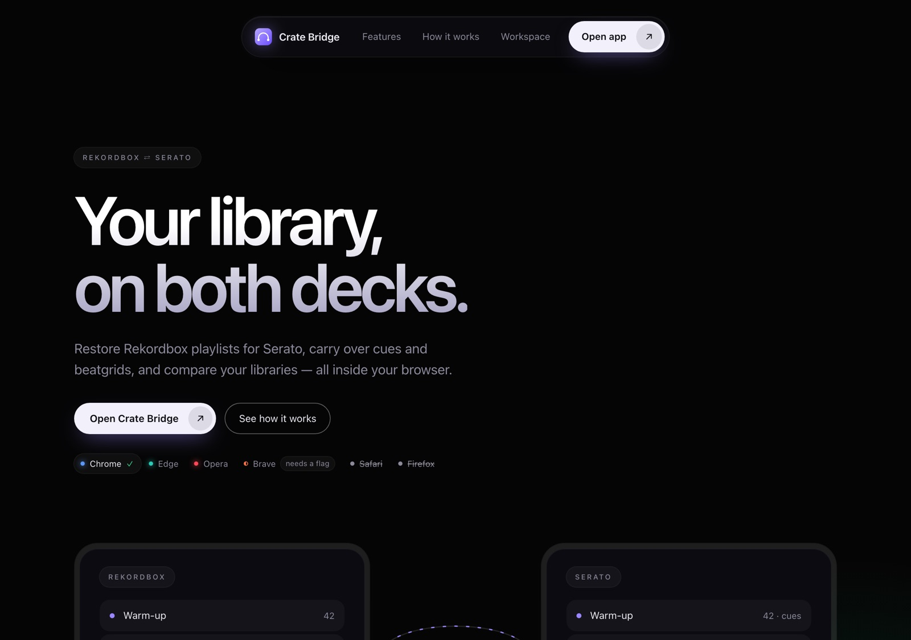
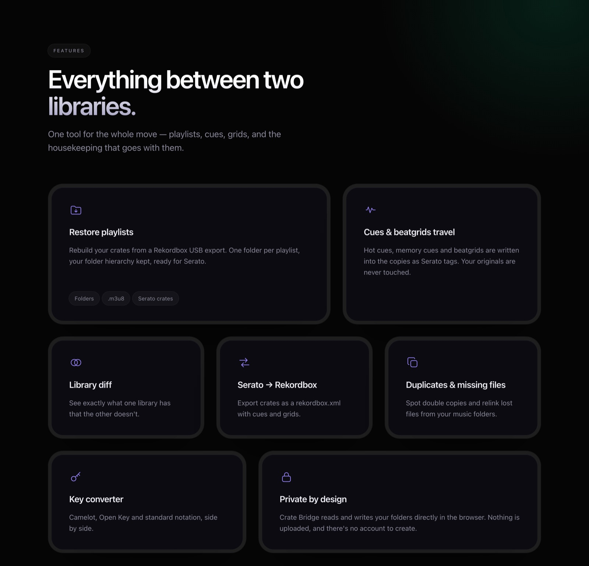
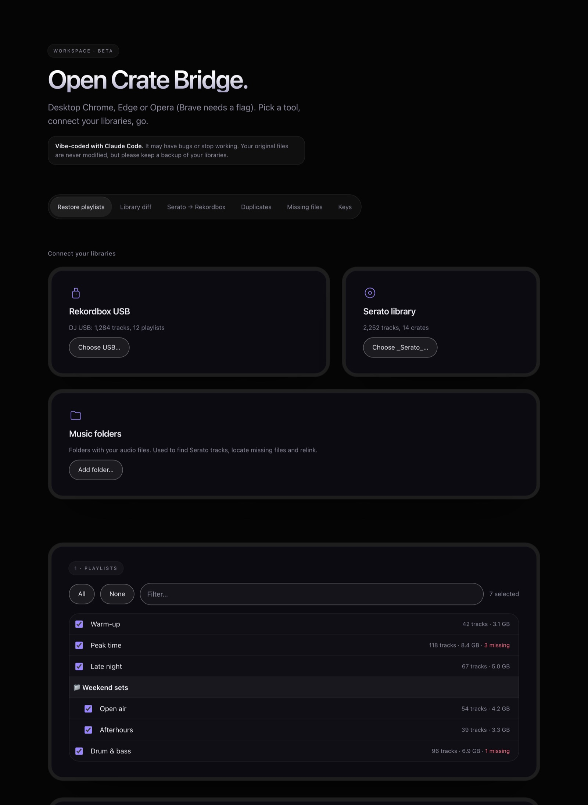

<div align="center">


# Crate Bridge

**Your library, on both decks.** Restore Rekordbox playlists for Serato, carry over cues and beatgrids,
and compare your libraries — entirely inside your browser.

[](https://github.com/RZFX/Crate-Bridge/actions/workflows/ci.yml)
[](LICENSE)




</div>

> [!WARNING]
> **Crate Bridge is vibe-coded.** It was built with [Claude Code](https://claude.com/claude-code) and has had only
> limited testing and review, so **it may have bugs, give wrong results, or stop working** (for example when
> Rekordbox or Serato change their file formats, or when your browser changes). It never modifies your original
> music files, but **keep a backup of your libraries** and try it on a copy or a few playlists first.
> No warranty — see the [license](LICENSE).

## What it does

| Tool | |
|---|---|
| **Restore playlists** | Reads a Rekordbox USB export and copies every playlist's tracks into a folder named after the playlist (folder hierarchy kept) — ready to drop into Serato. |
| **Cues & beatgrids** | Writes Rekordbox hot cues, memory cues and beatgrids into the *copies* as Serato tags (MP3, WAV, AIFF). Originals are never touched. |
| **Serato crates** | Creates the crates for you, straight into your `_Serato_` folder or into a folder to copy by hand. |
| **Library diff** | Shows which tracks are in Rekordbox but not Serato, and the other way round. |
| **Serato → Rekordbox** | Exports crates as a `rekordbox.xml` with cues and beatgrids. |
| **Duplicates · Missing files · Keys** | Find double copies, relink lost files from your music folders, convert Camelot / Open Key / standard notation. |

<div align="center">

</div>

## Quick start

**macOS** — double-click **`Crate Bridge.command`**. It starts a small local server and opens Crate Bridge in
Chrome, Edge or Opera. Keep the window open while you work; close it to stop.
Prefer a Dock app without a Terminal window? Run `tools/make-mac-app.sh` once.

**Any system with Node 22+**

```bash
git clone https://github.com/RZFX/Crate-Bridge.git
cd Crate-Bridge
npm start            # → http://localhost:8765  (open it in Chrome, Edge or Opera)
```

No install step — there are no packages to install. A hosted version on GitHub Pages is planned for release.

### Using it

<div align="center">

</div>

1. **Connect** — choose your Rekordbox USB (the drive root containing `PIONEER`), optionally your `_Serato_` folder
   and the folders where your music lives.
2. **Choose** — tick playlists, pick a destination, decide on cues/crates.
3. **Bridge** — copy. Restart Serato. Re-running skips files that are already there.

To import without crates, drag the destination folder from Serato's *Files* panel onto the crate list.
For `rekordbox.xml`: Rekordbox → Preferences → Advanced → Database → *rekordbox xml*, then drag playlists from the XML tree into your collection.

## Browser support

| Browser | |
|---|---|
| Chrome, Edge, Opera (desktop) | Supported |
| Brave (desktop) | Works after enabling `brave://flags/#file-system-access-api` |
| Safari, Firefox, mobile browsers | Not supported — they lack folder access |

## Privacy and security

- **Nothing is uploaded.** Files are read and written in place through the browser's folder access; the page has no
  server and a Content-Security-Policy that forbids network requests (`connect-src 'none'`).
- **Zero runtime dependencies**, no analytics, no fonts or scripts from a CDN.
- Library data is treated as untrusted: names are escaped, paths sanitised, parsers fuzz-tested.
- CI actions are pinned to commit SHAs; Dependabot, CodeQL, OpenSSF Scorecard and a weekly outdated-dependency check run on the repo.

Details, how to verify it in DevTools and a hardening checklist: [docs/security.md](docs/security.md).
To report a vulnerability see [SECURITY.md](SECURITY.md).

## Known limitations

- Only the USB **export** is read (`export.pdb` + analysis files). Rekordbox's own `master.db` is encrypted.
- Cues/grids can be embedded in **MP3, WAV and AIFF** only; FLAC/M4A are copied without them.
- Serato's tag formats are reverse-engineered. The output was verified with an independent reader and against
  Serato-written tags, but **not exhaustively inside Serato DJ** — check a few tracks after your first run.
- Memory cues have no Serato equivalent and fill free hot-cue slots (Serato has 8).
- Crates need the destination's absolute path; crates for tracks on *other* drives are unverified.
- Big copies run in a browser tab: keep it open and the computer awake.
- The launchers are macOS-only for now.

More help: [docs/troubleshooting.md](docs/troubleshooting.md).

## Development

```bash
npm start          # serve the site locally
npm run check      # lint (CSP / offline rules) + tests
npm run check:deps # outdated GitHub Actions, devDependencies and Node
```

```
index.html  css/  js/        the app (no build step)
test/                        unit + fuzz tests; test/manual/ needs real files
scripts/                     lint, dependency check, local server
tools/                       macOS launcher helpers
docs/                        architecture, security, troubleshooting
.github/                     CI, CodeQL, Scorecard, Dependabot, templates
```

Read [docs/architecture.md](docs/architecture.md) for how it works and [CONTRIBUTING.md](CONTRIBUTING.md) before opening a PR.

## Ideas

Windows/Linux launchers · FLAC cue support · a demo mode with sample data · verifying Serato's behaviour on external drives · Serato history import.

## License and trademarks

[MIT](LICENSE). Crate Bridge is an independent project and is not affiliated with or endorsed by AlphaTheta
(Pioneer DJ) or Serato. Rekordbox and Serato DJ are trademarks of their respective owners.
